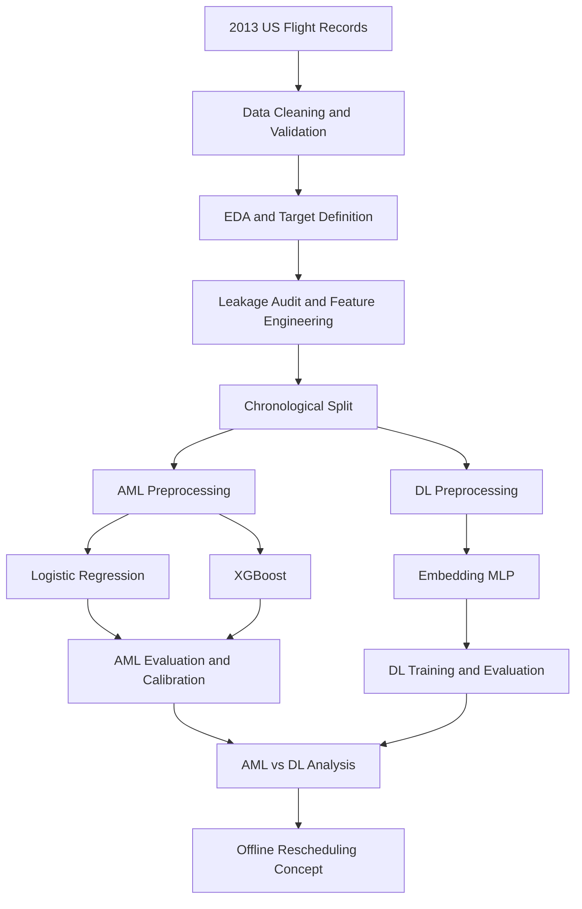

# ✈️ Flight-Club
### Flight Delay Prediction & Rescheduling Using Gradient Boosting and Deep Learning

<p align="center">
  
  
  
  
</p>

**Flight-Club** is a flight-delay prediction project developed by Team T004. It uses historical 2013 US domestic flight records to predict whether a flight will arrive more than 15 minutes after its scheduled arrival time. The project combines an Applied Machine Learning (AML) pipeline with a Deep Learning (DL) pipeline and investigates how predicted delay risk could support offline rescheduling decisions.

The project emphasizes leakage-safe feature engineering, chronological validation, threshold selection, probability calibration, and comparison of different modelling approaches.

> **Prediction-time principle:** Model inputs must contain only information available at the defined pre-departure prediction time. Actual departure and arrival outcomes must not be used as predictors.

---

## 📌 Table of Contents

- [Project Objectives](#-project-objectives)
- [Problem Definition](#-problem-definition)
- [Dataset](#-dataset)
- [Project Workflow](#-project-workflow)
- [Feature Engineering and Leakage Prevention](#-feature-engineering-and-leakage-prevention)
- [Chronological Data Split](#-chronological-data-split)
- [Applied Machine Learning Pipeline](#-applied-machine-learning-pipeline)
- [Deep Learning Pipeline](#-deep-learning-pipeline)
- [Results](#-results)
- [Offline Rescheduling Concept](#-offline-rescheduling-concept)
- [Repository Structure](#-repository-structure)
- [Technology Stack](#-technology-stack)
- [Getting Started](#-getting-started)
- [Team Contributions](#-team-contributions)
- [Limitations and Future Work](#-limitations-and-future-work)
- [References](#-references)

---

## 🎯 Project Objectives

1. Understand and validate historical flight data.
2. Explore flight-delay patterns and define a binary arrival-delay target.
3. Audit features for information leakage at prediction time.
4. Engineer temporal, route-based, and historical delay features.
5. Preserve chronological ordering across training, validation, and test sets.
6. Establish a Logistic Regression baseline.
7. Train and optimise an XGBoost classifier.
8. Develop a PyTorch MLP with learned embeddings for categorical variables.
9. Evaluate predictive performance, select thresholds, and examine probability calibration.
10. Compare traditional machine learning and deep learning approaches.
11. Explore how delay-risk predictions could inform hypothetical offline rescheduling decisions.

---

## 🧠 Problem Definition

The task is to predict whether a flight's actual arrival time is more than 15 minutes later than its scheduled arrival time.

This is formulated as a **binary classification problem**.

Let:

- \(A_i\) = actual arrival time of flight \(i\)
- \(S_i\) = scheduled arrival time of flight \(i\)

The arrival delay is:

\[
\text{Arrival Delay}_i = A_i - S_i
\]

The target variable is:

\[
y_i =
\begin{cases}
1, & \text{if Arrival Delay}_i > 15 \text{ minutes}\\
0, & \text{if Arrival Delay}_i \leq 15 \text{ minutes}
\end{cases}
\]

The models estimate:

\[
P(y_i = 1 \mid X_i)
\]

where \(X_i\) contains the selected pre-departure features.

Flights without a valid actual-arrival delay do not have a valid target under this definition and should not automatically be labelled as non-delayed.

---

## 📂 Dataset

The project uses **2013 US domestic flight records**. The repository includes compressed original and cleaned data files under `Data/`.

### Dataset files

| File | Description |
|---|---|
| `Data/flights (1).csv.zip` | Compressed original flight dataset |
| `Data/flights_cleaned_FINAL.csv.zip` | Compressed cleaned flight dataset |
| `Data_Dictionary.md` | Dataset columns, engineered features, target definition, and leakage guidance |

The project data contains **327,346 flight records** in the cleaned/feature-engineered workflow used by the modelling notebooks.

### Main data fields

| Feature group | Examples |
|---|---|
| Flight schedule | Scheduled departure and arrival times, month, day |
| Airline and route | `carrier`, `origin`, `dest`, route |
| Flight characteristics | `distance` |
| Historical statistics | Previous-seven-day delay rates and flight counts |
| Target | `delayed` |

### Target distribution

The DL validation report records:

- Total flights: **327,346**
- Non-delayed flights: **249,716 (76.29%)**
- Delayed flights: **77,630 (23.71%)**

The target is imbalanced, so accuracy is not sufficient as a standalone evaluation metric.

### Data access and generated artefacts

Some intermediate and model-input artefacts are generated by the notebooks or supplied between team members rather than stored as standalone CSV files in the repository. In particular, the preprocessing and DL notebooks may require:

- `flights_feature_engineered_CORRECTED.csv`
- `task3_outputs.zip` or the extracted Task 4 preprocessing outputs
- `dl_data.pt`

The `dl_data.pt` file contains the preprocessed PyTorch tensors and metadata used by the DL model. It is generated by the Deep Learning preprocessing workflow and is not the same file as `model_config.json`.

If these files are not available locally, obtain them from the project team's shared storage or regenerate them by running the relevant upstream notebook. Update file paths in the notebooks to match the location where the artefacts are stored.

---

## ⚙️ Project Workflow

The project is organised into two connected modelling tracks: Applied Machine Learning and Deep Learning.



### Project stages

| Stage | Work |
|---|---|
| 1 | Data understanding, validation, and cleaning |
| 2 | Exploratory data analysis and target definition |
| 3 | Leakage audit and feature engineering |
| 4 | Chronological splitting and preprocessing |
| 5 | Logistic Regression baseline |
| 6 | XGBoost classification and optimisation |
| 7 | Deep Learning preprocessing and embedding MLP architecture |
| 8 | DL training and hyperparameter experiments |
| 9 | DL evaluation, threshold selection, and calibration |
| 10 | AML/DL comparison and embedding ablation analysis |

---

## 🛡️ Feature Engineering and Leakage Prevention

The project uses a pre-departure prediction assumption. Features that reveal what happened after departure are excluded from model inputs.

### Excluded leakage-sensitive fields

| Field | Reason |
|---|---|
| `dep_time` | Actual departure time |
| `dep_delay` | Actual departure delay |
| `arr_time` | Actual arrival time |
| `arr_delay` | Used to construct the target |
| `air_time` | Known only after the flight |
| `id` | Identifier, not a predictive feature |
| `split` | Data-partition metadata, not a predictor |

Identifier-like fields such as `tailnum` and `flight` are reviewed separately rather than automatically treated as useful model inputs.

### Engineered feature families

**1. Cyclic temporal features**

Scheduled time and calendar variables are represented with sine and cosine transformations. For a periodic variable \(x\) with period \(T\):

\[
x_{\sin} = \sin\left(\frac{2\pi x}{T}\right)
\]

\[
x_{\cos} = \cos\left(\frac{2\pi x}{T}\right)
\]

The DL feature set includes cyclic encodings for departure time, arrival time, weekday, and month.

**2. Route and operational features**

The project uses airline, origin airport, destination airport, route, and distance information.

**3. Historical delay features**

Historical statistics describe delay behaviour over the preceding seven calendar days. These include:

- Origin airport delay rate and flight count
- Carrier delay rate and flight count
- Destination airport delay rate and flight count
- Route delay rate and flight count

Historical calculations must exclude the current date and current flight outcome. A zero historical count indicates that no earlier observations were available for that group.

### Deep Learning input features

The DL model uses **17 numerical features** and **4 categorical features**:

| Input type | Features |
|---|---|
| Numerical (17) | `distance`, `dep_time_sin`, `dep_time_cos`, `weekday_sin`, `weekday_cos`, `month_sin`, `month_cos`, `arr_time_sin`, `arr_time_cos`, `origin_delay_rate_prev7d`, `origin_flights_prev7d`, `carrier_delay_rate_prev7d`, `carrier_flights_prev7d`, `dest_delay_rate_prev7d`, `dest_flights_prev7d`, `route_delay_rate_prev7d`, `route_flights_prev7d` |
| Categorical (4) | `carrier`, `origin`, `dest`, `route` |
| Target | `delayed` |

The numerical and categorical feature order must remain consistent between preprocessing, training, evaluation, and inference.

---

## 🗓️ Chronological Data Split

The project uses a chronological split rather than a random split. This simulates predicting future flights using patterns learned from earlier flights.

| Partition | Period | Number of flights | Delayed rate |
|---|---|---:|---:|
| Training | January–August 2013 | 217,727 | 25.61% |
| Validation | September–October 2013 | 55,628 | 15.05% |
| Test | November–December 2013 | 53,991 | 24.99% |
| **Total** | **January–December 2013** | **327,346** | **23.71%** |

- Training data is used to fit preprocessing transformations and model parameters.
- Validation data is used for model selection, hyperparameter tuning, and threshold selection.
- Test data is reserved for final evaluation.

The difference in delayed-flight prevalence between validation and test periods is important when interpreting threshold performance and calibration.

---

## 📈 Applied Machine Learning Pipeline

The AML workflow is implemented in `notebooks_AML/`.

### 1. Logistic Regression

Logistic Regression provides an interpretable baseline for binary classification. It estimates the probability of a delay using a logistic function:

\[
P(y=1 \mid X) = \frac{1}{1 + e^{-z}}
\]

where \(z\) is a linear combination of the input features and learned coefficients.

### 2. XGBoost

XGBoost is a gradient-boosted decision-tree model. It builds an ensemble of trees to capture nonlinear relationships and interactions among flight, airline, route, and historical features.

The XGBoost workflow includes:

- Validation-based early stopping
- A baseline threshold of 0.50
- Validation-based F1 threshold selection
- Held-out test evaluation
- Feature-importance export
- Hyperparameter search and probability calibration in the AML optimisation notebook

### AML evaluation

The final AML optimisation notebook reports test metrics after probability calibration and validation-based threshold selection. The results are shown in the [Results](#-results) section.

---

## 🧠 Deep Learning Pipeline

The DL workflow is implemented in `notebooks_DL/` and consists of six notebooks.

### 1. Data Validation

`01_DL_Data_Validation/01_DL_Data_Validation.ipynb`

- Checks dataset shape, columns, and data types.
- Inspects duplicate records and missing values.
- Examines target distribution.
- Verifies chronological split boundaries.
- Checks numerical and categorical feature definitions.
- Reviews unseen categories and leakage-sensitive fields.

### 2. Preprocessing

`02_DL_Preprocessing/02_DL_Preprocessing.ipynb`

- Reuses the chronological train, validation, and test split.
- Handles missing numerical values using training-set statistics.
- Standardises numerical features using training data.
- Creates categorical mappings and integer encodings.
- Handles unseen categories.
- Converts data into PyTorch tensors.
- Creates DataLoaders and saves the DL data artefact.

### 3. Embedding MLP Architecture

`03_Embedding_MLP_Architecture/03_Embedding_MLP_Architecture.ipynb`

The architecture combines numerical features with trainable categorical embeddings.

| Component | Configuration |
|---|---|
| Numerical inputs | 17 |
| Categorical embeddings | Carrier, origin, destination, route |
| Combined input dimension | 128 |
| Hidden layers | 128 → 64 → 32 |
| Activation | ReLU |
| Dropout | 0.3 and 0.2 |
| Output | One raw delay logit |
| Trainable parameters | 43,142 |

The notebook also contains the reusable `FlightDelayMLP` class, `model.py`, and `model_config.json`.

The output layer produces a raw logit. A sigmoid transformation is applied when probabilities are needed during evaluation or inference.

### 4. Training and Hyperparameter Tuning

`04_Hyperparameter_Tuning/04_Deep_Learning_Training_Hyperparameter_Tuning.ipynb`

The training workflow includes:

- `BCEWithLogitsLoss`
- AdamW optimiser
- Early stopping
- Validation-loss monitoring
- Experiments with learning rate, batch size, architecture, dropout, and class weighting
- Saving the best model checkpoint and experiment summaries

The saved training archive contains the best checkpoint, hyperparameter configuration, experiment comparison, training history, and loss plot.

### 5. Evaluation and Calibration

`05_DL_Evaluation_and_Calibration/05_DL_Evaluation_and_Calibration.ipynb`

This notebook:

- Reconstructs the trained model from its checkpoint.
- Generates validation and test probabilities.
- Calculates classification metrics and ROC/precision-recall curves.
- Selects an F1-oriented threshold using validation predictions.
- Examines an illustrative operational precision threshold.
- Calculates Brier score and plots calibration curves.
- Saves predictions, metrics, thresholds, and evaluation plots.

### 6. AML vs DL Comparison

`06_AML_DL_Comparison/6_AML_vs_DL_Comparison .ipynb`

The comparison notebook includes:

- Overall model comparison
- Categorical embedding ablation experiments
- Trainable parameter counts
- Training-time comparison
- Inference-time comparison
- Visualisations and saved comparison tables

The saved comparison is useful as an exploratory analysis, but the current comparison table combines AML values recorded at a different split/threshold setup from the DL test values. It should therefore **not be interpreted as a definitive like-for-like model ranking**. See the [Results](#-results) section for the evaluation details and caveats.

---

## 📊 Results

The results below are transcribed from the saved notebook output archives included in the repository. Metrics should always be interpreted alongside the evaluation split and threshold strategy.

### 1. Final AML test results

The AML optimisation notebook reports the following results on the 53,991-flight test set after calibration and validation-based threshold selection.

| Metric | Logistic Regression | XGBoost |
|---|---:|---:|
| Accuracy | 73.86% | 73.51% |
| Precision | 41.21% | 40.08% |
| Recall | 10.78% | 12.15% |
| F1-score | 17.09% | 18.65% |
| ROC-AUC | 0.6187 | 0.6392 |
| PR-AUC | 0.3387 | 0.3553 |
| Brier score | 0.1942 | 0.1919 |

**AML interpretation:** XGBoost has higher ROC-AUC, PR-AUC, recall, and F1-score than Logistic Regression in this final AML evaluation. However, recall remains low for both models, meaning that many delayed flights are not detected at the selected operating thresholds.

The test-set delayed-flight prevalence is approximately 24.99%. An always-on-time classifier would achieve approximately 75.01% accuracy while detecting none of the delayed flights, illustrating why accuracy alone is misleading.

### 2. Deep Learning test results

The saved DL evaluation archive reports the following results using the threshold selected to maximise validation F1.

| Metric | Embedding + MLP |
|---|---:|
| Selected threshold | 0.176459 |
| Accuracy | 53.28% |
| Precision | 30.99% |
| Recall | 70.89% |
| F1-score | 43.13% |
| ROC-AUC | 0.6377 |
| PR-AUC | 0.3612 |
| Brier score | 0.1811 |

**DL interpretation:** At the validation-selected F1 threshold, the MLP identifies a larger proportion of delayed flights, with higher recall. This comes with a lower precision and accuracy, meaning more non-delayed flights are also flagged.

At the default threshold of 0.50, the saved DL test results show recall of approximately 0.64%. Threshold choice therefore has a substantial effect on the model's classification behaviour.

The notebook also tests an illustrative operational threshold targeting 50% precision on validation data. That threshold does not transfer successfully to the test period and produces no detected delayed flights. This highlights the effect of temporal distribution shift.

### 3. Important comparison caveat

The repository's saved `aml_vs_dl_final_comparison.csv` places AML values recorded at a 0.50 validation threshold alongside MLP values recorded on the test set at its validation-F1-selected threshold. These are not equivalent evaluation conditions.

The project presentation also notes that exact row-level alignment and final checkpoint consistency should be reconfirmed. Therefore:

- Do not use that CSV alone to claim that one model definitively outperforms all others.
- Compare models using the same test observations and clearly stated threshold-selection rules.
- Report threshold-independent metrics such as ROC-AUC and PR-AUC separately from threshold-dependent metrics such as precision, recall, and F1-score.
- Keep the test set out of model and threshold selection.

### 4. Embedding ablation

The saved ablation results compare the full four-embedding MLP with models that remove one or more categorical embeddings.

| Experiment | Retained embeddings | PR-AUC (AP) | ROC-AUC | F1-score | Trainable parameters |
|---|---|---:|---:|---:|---:|
| Full model | Carrier, origin, destination, route | 0.3668 | 0.6417 | 0.4317 | 43,142 |
| Without carrier | Origin, destination, route | 0.3627 | 0.6374 | 0.4319 | 41,837 |
| Without origin | Carrier, destination, route | 0.3689 | 0.6432 | 0.4358 | 42,878 |
| Without destination | Carrier, origin, route | 0.3708 | 0.6451 | 0.4369 | 31,592 |
| Without route | Carrier, origin, destination | 0.3691 | 0.6452 | 0.4381 | 25,792 |
| Without all embeddings | None | 0.3606 | 0.6470 | 0.4408 | 12,673 |

The ablation results show that removing embeddings reduces model size, but does not consistently reduce every reported metric. In this experiment, the full model does not achieve the highest F1-score or ROC-AUC among the ablation variants. The contribution of each embedding should therefore be interpreted from the full set of metrics rather than assuming every embedding improves performance.

---

## 🔄 Offline Rescheduling Concept

The project considers how predicted delay probabilities could support hypothetical rescheduling decisions.

The intended concept is an **offline what-if analysis**, not a live airline scheduling optimiser. A possible analysis would:

1. Generate delay-risk probabilities for eligible flights.
2. Define explicit operational assumptions and constraints.
3. Identify flights that may be candidates for hypothetical schedule changes.
4. Compare predicted risks under the original and proposed schedules.
5. Report potential trade-offs and limitations.

Possible constraints include minimum turnaround times, airport capacity assumptions, feasible departure/arrival windows, and restrictions on the extent of schedule changes.

The repository does not contain a dedicated executable rescheduling/scheduling-optimisation notebook. Accordingly, rescheduling should be treated as a proposed application of the prediction pipeline, not as a demonstrated operational system. A lower predicted risk after a hypothetical change would not prove that a real delay would have been prevented.

---

## 📁 Repository Structure

```text
T004-Flight-Club/
│
├── README.md
├── Data_Dictionary.md
│
├── Data/
│   ├── flights (1).csv.zip
│   └── flights_cleaned_FINAL.csv.zip
│
├── Presentation/
│   ├── aml_presentation/
│   │   ├── T004_Flight_Club_presentation.pdf
│   │   └── T004_Flight_Club_presentation.pptx
│   └── dl_presentation/
│       ├── T004_Flight_Club_presentation.pdf
│       └── T004_Flight_Club_presentation.pptx
│
├── Report/
│   └── aml_report/
│       └── Flight_Club_Final_Report.pdf
│
├── Report_DL/
│   └── Flight_Club_Report_DL.pdf
│
├── notebooks_AML/
│   ├── 01_EDA_Target/
│   │   ├── 01_EDA_target.ipynb
│   │   └── flights_clean.csv
│   ├── 02_Feature_Engineering/
│   │   ├── 02_Feature_Engineering.ipynb
│   │   └── flights_feature_engineered_CORRECTED.csv.zip
│   ├── 03_Chronological_split_preprocessing/
│   │   ├── 03_Chronological_split_preprocessing.ipynb
│   │   └── task3_outputs.zip
│   ├── 04_Logistic_Regression/
│   │   ├── 04_Logistic_Regression_UPDATED.ipynb
│   │   └── Task4_Logistic_Regression.zip
│   ├── 05_XGBoost_Flight_Delay/
│   │   └── 05_XGBoost_Flight_Delay.ipynb
│   └── 06_AML_Model_Optimization_Calibration/
│       └── 06_AML_Model_Optimization_Calibration.ipynb
│
└── notebooks_DL/
    ├── 01_DL_Data_Validation/
    │   └── 01_DL_Data_Validation.ipynb
    ├── 02_DL_Preprocessing/
    │   └── 02_DL_Preprocessing.ipynb
    ├── 03_Embedding_MLP_Architecture/
    │   ├── 03_Embedding_MLP_Architecture.ipynb
    │   ├── model.py
    │   └── model_config.json
    ├── 04_Hyperparameter_Tuning/
    │   ├── 04_Deep_Learning_Training_Hyperparameter_Tuning.ipynb
    │   └── DL_Training_Results.zip
    ├── 05_DL_Evaluation_and_Calibration/
    │   ├── 05_DL_Evaluation_and_Calibration.ipynb
    │   └── DL_Evaluation_Results.zip
    └── 06_AML_DL_Comparison/
        ├── 6_AML_vs_DL_Comparison .ipynb
        └── AML_DL_Comparison_Results.zip
```

*The repository also contains generated outputs inside the result ZIP archives. Some intermediate data archives are expected to be generated or supplied separately as described in the Dataset section.*

---

## 🛠️ Technology Stack

| Technology | Purpose |
|---|---|
| Python | Core programming language |
| Pandas, NumPy | Data manipulation and numerical processing |
| Matplotlib, Seaborn | Data visualisation |
| Scikit-learn | Preprocessing, Logistic Regression, metrics, and calibration |
| XGBoost | Gradient-boosted decision-tree model |
| PyTorch | Embedding-based MLP and deep learning |
| Jupyter Notebook / Google Colab | Notebook development and execution |
| Git and GitHub | Version control and team collaboration |

---

## 🚀 Getting Started

### 1. Clone the repository

```bash
git clone https://github.com/suhanigupta786/T004-Flight-Club.git
cd T004-Flight-Club
```

### 2. Create and activate a virtual environment

```bash
python3 -m venv .venv
source .venv/bin/activate
```

On Windows:

```bash
.venv\Scripts\activate
```

### 3. Install the main dependencies

```bash
pip install pandas numpy matplotlib seaborn scikit-learn xgboost torch jupyter joblib
```

Depending on the notebook and environment, additional packages may be required. Install any missing package reported by the notebook.

### 4. Obtain the required data and intermediate artefacts

Start with the compressed data files in `Data/`. Run the AML notebooks in sequence to generate the feature-engineered and preprocessing artefacts.

For the DL pipeline, ensure the following files are available in the paths expected by the notebooks:

- Feature-engineered dataset
- `dl_data.pt`
- `model.py`
- `model_config.json`
- DL training checkpoint/result archive for evaluation

The training and evaluation result ZIP files are included in the repository. The `dl_data.pt` tensor file is generated by the DL preprocessing notebook and may need to be transferred from the shared project workspace.

### 5. Run the notebooks in order

**AML workflow**

1. `notebooks_AML/01_EDA_Target/01_EDA_target.ipynb`
2. `notebooks_AML/02_Feature_Engineering/02_Feature_Engineering.ipynb`
3. `notebooks_AML/03_Chronological_split_preprocessing/03_Chronological_split_preprocessing.ipynb`
4. `notebooks_AML/04_Logistic_Regression/04_Logistic_Regression_UPDATED.ipynb`
5. `notebooks_AML/05_XGBoost_Flight_Delay/05_XGBoost_Flight_Delay.ipynb`
6. `notebooks_AML/06_AML_Model_Optimization_Calibration/06_AML_Model_Optimization_Calibration.ipynb`

**Deep Learning workflow**

1. `notebooks_DL/01_DL_Data_Validation/01_DL_Data_Validation.ipynb`
2. `notebooks_DL/02_DL_Preprocessing/02_DL_Preprocessing.ipynb`
3. `notebooks_DL/03_Embedding_MLP_Architecture/03_Embedding_MLP_Architecture.ipynb`
4. `notebooks_DL/04_Hyperparameter_Tuning/04_Deep_Learning_Training_Hyperparameter_Tuning.ipynb`
5. `notebooks_DL/05_DL_Evaluation_and_Calibration/05_DL_Evaluation_and_Calibration.ipynb`
6. `notebooks_DL/06_AML_DL_Comparison/6_AML_vs_DL_Comparison .ipynb`

The notebooks use Google Colab-style file uploads and paths in places. When running locally, update those paths and ensure that all required generated artefacts are available.

---


## 👥 Team Contributions

The Flight-Club project was completed in two phases: Applied Machine Learning (Phase 1) and Deep Learning (Phase 2). Responsibilities were distributed among the five team members as follows.

### Phase 1 — Applied Machine Learning (AML)

| Team Member | Responsibilities |
|---|---|
| **Suhani Gupta** | Dataset understanding, data dictionary, leakage audit, and feature engineering |
| **Khushi Jain** | Exploratory Data Analysis (EDA) and target definition |
| **Khyati Batra** | Chronological data splitting and preprocessing |
| **Akshat Agrawal** | Logistic Regression baseline |
| **Agrima Ojha** | XGBoost classifier, model evaluation, comparison, and final analysis |

### Phase 2 — Deep Learning (DL)

| Team Member | Member Role | Responsibilities |
|---|---|---|
| **Khushi Jain** | Member 1 | Data validation and preprocessing, chronological split verification, categorical encoding, numerical scaling, tensor preparation, and DataLoader creation |
| **Suhani Gupta** | Member 2 | MLP architecture design, categorical embedding layers, model implementation, forward-pass verification, and trainable parameter analysis |
| **Agrima Ojha** | Member 3 | Deep Learning model training, hyperparameter tuning, optimisation, early stopping, and best model checkpoint selection |
| **Khyati Batra** | Member 4 | Deep Learning model evaluation, performance metrics, threshold selection, and probability calibration |
| **Akshat Agrawal** | Member 5 | AML vs DL comparison, embedding ablation experiments, computational analysis, visualisations, and experiment interpretation |

Each phase involved collaborative development, integration, testing, and documentation to build a complete flight-delay prediction workflow combining traditional machine learning and deep learning approaches.


---

## ⚠️ Limitations and Future Work

### Limitations

- The dataset contains flights from 2013; its patterns may not represent current airline operations.
- Delay prevalence changes between the validation and test periods, affecting threshold transfer and calibration.
- Historical delay rates are backward-looking summaries, not real-time airport congestion measurements.
- Threshold-dependent metrics can change substantially with the chosen threshold.
- The saved AML/DL comparison requires a common evaluation protocol before making definitive model-ranking claims.
- The offline rescheduling concept is not a live scheduling optimiser and does not prove that a proposed schedule change would prevent a delay.
- Real-world deployment would require more recent data, operational constraints, and ongoing monitoring for distribution shift.

### Future improvements

- Validate the pipeline on more recent flight records.
- Add weather and operational data, provided they are available at prediction time.
- Investigate more robust temporal validation strategies.
- Re-run AML and DL models using exactly aligned test observations and a clearly documented comparison protocol.
- Study threshold selection under changing delay prevalence and operational costs.
- Improve probability calibration and monitor calibration drift.
- Implement a dedicated offline rescheduling experiment with explicit feasibility constraints and measurable objectives.

---

## 📚 References

1. U.S. Bureau of Transportation Statistics — [Airline On-Time Performance Data](https://www.transtats.bts.gov/ONTIME/).
2. Kaggle — [Flights datasets](https://www.kaggle.com/datasets/).
3. Chen, T. and Guestrin, C. (2016). *XGBoost: A Scalable Tree Boosting System*. Proceedings of the 22nd ACM SIGKDD International Conference on Knowledge Discovery and Data Mining.
4. Paszke, A. et al. (2019). *PyTorch: An Imperative Style, High-Performance Deep Learning Library*. Advances in Neural Information Processing Systems.
5. Guo, C., Pleiss, G., Sun, Y., and Weinberger, K. Q. (2017). *On Calibration of Modern Neural Networks*. Proceedings of the 34th International Conference on Machine Learning.

---

<p align="center">
  <b>✈️ Flight-Club — Team T004</b><br>
  Predicting flight delay risk through data-driven modelling and exploring smarter scheduling decisions.
</p>
